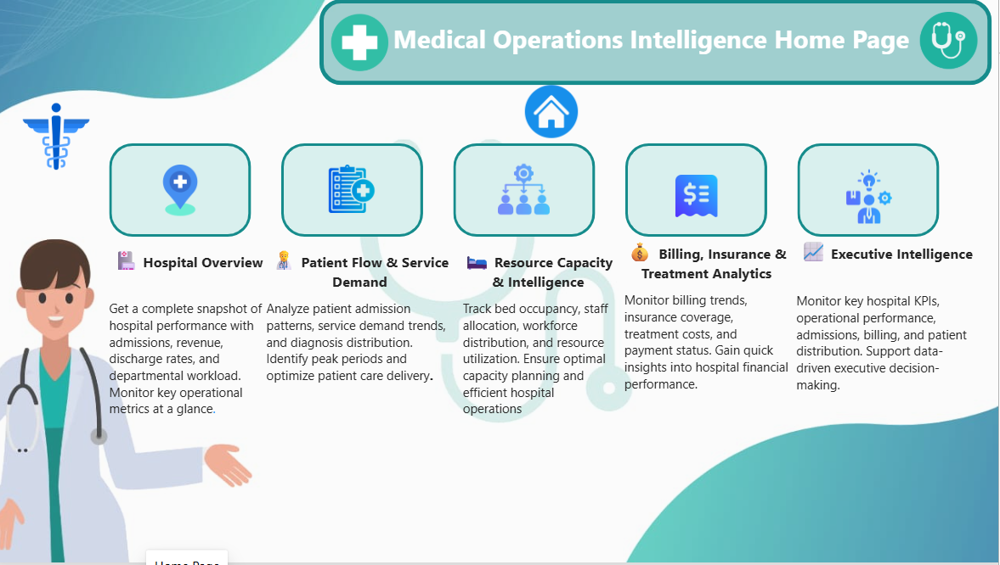

🏥 Medical Operations Intelligence Dashboard

Transforming Hospital Data into Actionable Business Insights Using Python & Power BI

📌 Project Overview

The Medical Operations Intelligence Dashboard is an end-to-end healthcare analytics project designed to help hospital administrators monitor operational performance, evaluate resource utilization, analyze patient flow, and make data-driven business decisions.

Hospitals generate large volumes of data related to patients, admissions, discharges, departments, doctors, wards, facilities, prescriptions, and billing. Analyzing these datasets independently makes it difficult for management to identify operational inefficiencies and performance gaps.

This project integrates multiple healthcare datasets, performs data cleaning and transformation using Python, and develops interactive Power BI dashboards to convert raw hospital data into meaningful operational insights.

The dashboard focuses on five major areas: executive performance, patient admissions, financial performance, resource utilization, and management intelligence.

🎯 Business Objectives

- Monitor overall hospital performance through centralized KPIs.
- Analyze patient admissions and discharge patterns.
- Evaluate hospital revenue and billing performance.
- Identify departments and wards with high operational workloads.
- Understand patient distribution and healthcare service utilization.
- Monitor length of stay and discharge efficiency.
- Support hospital management in identifying operational bottlenecks.

🛠️ Technology Stack

Technology| Purpose
Python| Data cleaning and preprocessing
Pandas| Data manipulation and transformation
NumPy| Numerical operations
Power BI| Interactive dashboard development
DAX| KPI calculations and business metrics
Power Query| Data transformation
Data Modeling| Relationships between healthcare datasets
Excel / CSV| Source data management

🔄 Project Workflow

1. Data Collection: Gathered multiple hospital operational datasets.
2. Data Understanding: Explored tables, columns, data types, and relationships.
3. Data Cleaning: Handled missing values, duplicates, inconsistent formats, and invalid records using Python.
4. Data Transformation: Prepared cleaned datasets for analytical reporting.
5. Data Modeling: Established relationships between patient, admission, billing, department, ward, and other healthcare tables.
6. DAX Development: Created measures for KPIs, trends, ratios, and performance analysis.
7. Dashboard Development: Designed interactive Power BI report pages.
8. Business Analysis: Translated dashboard findings into actionable management insights.

📊 Dashboard Pages & Business Questions

Page 1 – Executive Overview & Hospital Performance

Business Objective: Provide hospital management with a centralized overview of overall operational and financial performance.

Key KPIs:

- Total Admissions
- Total Patients
- Total Billing
- Average Length of Stay (LOS)
- Discharged Admissions
- Discharge Rate

Business Questions & Answers

Q1. How many patients are being treated or admitted to the hospital?

Answer: Total Admissions and Total Patients KPIs provide visibility into hospital demand and patient volume. Comparing these metrics helps management understand admission activity and patient reach.

Q2. How much revenue is generated by hospital operations?

Answer: Total Billing measures the overall billing amount generated across the selected reporting period. The project dataset shows approximately ₹495.41 million in total billing.

Q3. How efficiently are patients being discharged?

Answer: Discharged Admissions and Discharge Rate help management evaluate discharge performance. A lower discharge rate may indicate longer stays, discharge delays, or a higher proportion of ongoing admissions.

Q4. How long do patients typically stay in the hospital?

Answer: Average LOS measures the average duration of hospital stays. The observed average is approximately five days, subject to the selected filters and reporting context.

Management Insight: Executive KPIs provide a quick understanding of patient demand, financial performance, and operational efficiency, helping management identify areas that require further investigation.

Page 2 – Patient Admissions & Trend Analysis

Business Objective: Understand admission patterns and identify changes in patient demand over time.

Business Questions & Answers

Q1. How do hospital admissions change monthly and yearly?

Answer: Monthly and yearly admission trend analysis helps identify changes in patient demand and periods of increased hospital activity.

Q2. Which admission periods experience higher patient volumes?

Answer: Time-based analysis highlights peak admission periods. Management can use these patterns to plan staffing, bed availability, and operational resources.

Q3. Which departments receive the highest number of admissions?

Answer: Department-wise admission analysis identifies departments handling larger patient volumes. These departments may require closer monitoring of workforce and infrastructure capacity.

Q4. How does patient demand vary across admission categories?

Answer: Admission-type analysis helps management understand the distribution of different admission categories and evaluate changes in service demand.

Management Insight: Admission trends support capacity planning, resource allocation, and preparation for periods of higher patient demand.

Page 3 – Financial Performance & Revenue Analysis

Business Objective: Evaluate hospital billing performance and understand revenue contribution across different operational categories.

Key Metrics:

- Total Billing
- Average Billing
- Monthly Billing
- Department-wise Billing
- Ward-wise Billing
- Facility-wise Revenue

Business Questions & Answers

Q1. How does hospital revenue change over time?

Answer: Monthly billing trends reveal revenue fluctuations and identify periods of higher or lower billing activity.

Q2. Which departments contribute the most to hospital revenue?

Answer: Department-wise billing comparisons identify the major revenue-contributing departments. Management can investigate the factors driving their financial performance.

Q3. Which wards generate higher billing amounts?

Answer: Ward-wise billing analysis highlights revenue contribution across wards and supports comparisons of financial performance.

Q4. Which hospital facilities generate higher revenue?

Answer: Facility-level analysis compares billing contributions across facilities and helps management evaluate financial performance at different locations.

Q5. Is revenue increasing or decreasing over time?

Answer: Billing trend analysis helps identify revenue growth or decline across reporting periods, supporting financial planning and performance monitoring.

Management Insight: Financial analysis helps hospital administrators understand revenue distribution, identify major contributors, and investigate opportunities to improve financial performance.

Page 4 – Department, Ward & Resource Utilization

Business Objective: Evaluate operational workloads and understand how hospital resources are utilized across departments and wards.

Business Questions & Answers

Q1. Which departments handle the highest number of admissions?

Answer: Department-wise admission analysis identifies high-volume departments. Management can review their staffing requirements and service capacity.

Q2. Which wards have higher patient workloads?

Answer: Ward-level analysis highlights differences in patient volume and billing activity, helping management identify wards that may require additional operational attention.

Q3. Which departments have higher average patient stays?

Answer: Average LOS by department helps identify departments where patients typically remain hospitalized longer. Further investigation can help identify potential discharge or treatment-process bottlenecks.

Q4. How efficiently are hospital facilities utilizing their resources?

Answer: Facility-level comparisons using admissions, patients, billing, average LOS, and discharge rate help management understand differences in operational performance.

Q5. Are there departments that require management attention?

Answer: Departments with high admission volumes, longer patient stays, or comparatively low discharge rates can be flagged for further investigation.

Management Insight: Resource utilization analysis supports better workforce planning, departmental performance monitoring, and operational efficiency improvements.

Page 5 – Executive Intelligence & Drill-through Analysis

Business Objective: Provide management with detailed analytical capabilities to investigate operational exceptions and identify areas requiring attention.

Business Questions & Answers

Q1. Which departments or wards need immediate management attention?

Answer: Department and ward performance comparisons help identify areas with high workloads, longer stays, or unusual billing and discharge patterns.

Q2. Which facilities show comparatively weaker operational performance?

Answer: Facility scorecards allow management to compare admissions, patients, revenue, average LOS, and discharge rate to identify performance gaps.

Q3. How can management investigate the reason behind a KPI change?

Answer: Interactive drill-through functionality allows users to move from summary-level visuals to detailed department or operational records.

Q4. Can management identify unusual operational patterns?

Answer: Exception tables and conditional formatting help highlight records or categories that require further investigation.

Q5. How can management explore detailed department performance?

Answer: Department-level drill-through provides additional information about admissions, discharges, billing, average LOS, and patient details.

Management Insight: Executive intelligence and drill-through capabilities transform summary reporting into an investigation-oriented decision-support experience.

📈 Key KPIs & DAX Measures

KPI| Business Purpose
Total Admissions| Measures total admission records
Total Patients| Measures unique patients
Total Billing| Calculates total hospital billing
Average LOS| Measures average patient stay duration
Discharged Admissions| Counts admissions with discharge dates
Discharge Rate| Measures the percentage of discharged admissions
Monthly Admissions| Tracks admission trends over time
Monthly Billing| Tracks revenue trends over time
Department Billing| Compares revenue across departments
Ward Billing| Evaluates ward-level billing performance
Facility Performance| Compares operational performance across facilities

Important DAX Formulas

Total Admissions

Total Admissions =
DISTINCTCOUNT(admission_clean[admission_id])

Total Patients

Total Patients =
DISTINCTCOUNT(admission_clean[patient_id])

Total Billing

Total Billing =
SUM(billing_clean[billing_amount])

Average Length of Stay

Average LOS =
AVERAGE(admission_clean[length_of_stay])

Discharged Admissions

Discharged Admissions =
CALCULATE(
    [Total Admissions],
    NOT ISBLANK(admission_clean[discharge_date])
)

Discharge Rate

Discharge Rate =
DIVIDE(
    [Discharged Admissions],
    [Total Admissions],
    0
)

Note: These formulas represent the core KPI logic. Adjust table and column names to match the final Power BI model.

📊 Interactive Dashboard Features

- Dynamic slicers and filters.
- Monthly and yearly trend analysis.
- Department-wise and ward-wise comparisons.
- Facility-level performance analysis.
- Interactive KPI cards.
- Conditional formatting for performance monitoring.
- Bookmark-based visual switching.
- Drill-through pages for detailed analysis.
- Reset Filters functionality.
- Multiple date-based analytical views.

💡 Key Business Recommendations

Based on the analytical framework, hospital management can:

1. Improve capacity planning: Use admission trends to anticipate periods of higher patient demand.
2. Optimize workforce allocation: Review staffing requirements in departments with higher patient workloads.
3. Improve discharge efficiency: Investigate departments with longer average stays or lower discharge rates.
4. Monitor financial performance: Track revenue contribution across departments, wards, and facilities.
5. Strengthen operational monitoring: Use exception tables and drill-through analysis to investigate performance gaps.
6. Improve resource utilization: Compare operational metrics across facilities to identify opportunities for improvement.

📁 Project Structure

Medical_operations_project/
│
├── Dashboard/
│   └── Power BI dashboard files
│
├── Data Modeling/
│   └── Data model documentation
│
├── Dax/
│   └── DAX measures and calculations
│
├── Screenshots/
│   └── Dashboard screenshots
│
├── data/
│   ├── Raw datasets
│   └── Cleaned datasets
│
├── python file/
│   └── Data cleaning and preprocessing scripts
│
└── README.md

🚀 Project Outcome

This project demonstrates how raw healthcare operational data can be transformed into meaningful business intelligence using Python and Power BI.

It provides hospital administrators with a structured approach to monitoring patient admissions, financial performance, discharge efficiency, and resource utilization.

The solution demonstrates practical skills in data preprocessing, data modeling, DAX development, interactive visualization, KPI reporting, and business analysis.

👩‍💻 Author

Vidhya S.

Aspiring Data Analyst | Power BI Developer

GitHub: https://github.com/vidhya330

---

⭐ If you find this project useful, consider giving the repository a star.
